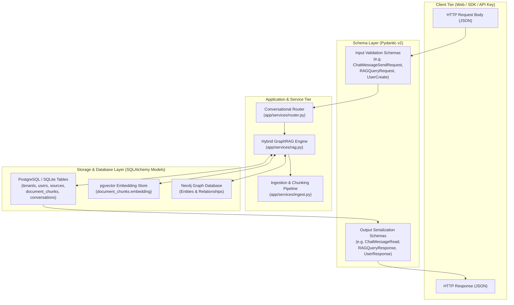

# Architectural Reference: Database Models & Pydantic Schemas

This document provides a comprehensive, technical reference of every **SQLAlchemy Model** and **Pydantic Schema** implemented in the OmniGraph Enterprise Hybrid GraphRAG platform (`app/models/` and `app/schemas/`).

---

## Table of Contents
1. [Core Architectural Paradigm: Models vs. Schemas](#1-core-architectural-paradigm-models-vs-schemas)
2. [SQLAlchemy Database Models (`app/models/`)](#2-sqlalchemy-database-models-appmodels)
   - [Base & Mixins (`app/models/base.py`)](#21-base--mixins-appmodelsbasepy)
   - [Tenant (`app/models/tenant.py`)](#22-tenant-appmodelstenantpy)
   - [User (`app/models/user.py`)](#23-user-appmodelsuserpy)
   - [Item (`app/models/item.py`)](#24-item-appmodelsitempy)
   - [Source (`app/models/source.py`)](#25-source-appmodelssourcepy)
   - [DocumentChunk (`app/models/chunk.py`)](#26-documentchunk-appmodelschunkpy)
   - [ChatbotConfig (`app/models/chatbot.py`)](#27-chatbotconfig-appmodelschatbotpy)
   - [Conversation & ChatMessage (`app/models/conversation.py`)](#28-conversation--chatmessage-appmodelsconversationpy)
   - [AIProfile, AIProfileVersion, Persona & AIProfileEvalCase (`app/models/ai_profile.py`)](#29-aiprofile-aiprofileversion-persona--aiprofileevalcase-appmodelsai_profilepy)
   - [TenantApiKey (`app/models/api_key.py`)](#210-tenantapikey-appmodelsapi_keypy)
   - [UsageEvent (`app/models/usage.py`)](#211-usageevent-appmodelsusagepy)
3. [Pydantic Schemas (`app/schemas/`)](#3-pydantic-schemas-appschemas)
   - [Multi-Tenancy & Organization Management (`tenant.py`)](#31-multi-tenancy--organization-management-tenantpy)
   - [User Management (`user.py`)](#32-user-management-userpy)
   - [Authentication & Registration (`auth.py`)](#33-authentication--registration-authpy)
   - [Demonstration Entity (`item.py`)](#34-demonstration-entity-itempy)
   - [Knowledge Source Ingestion (`source.py`)](#35-knowledge-source-ingestion-sourcepy)
   - [Document Chunks (`chunk.py`)](#36-document-chunks-chunkpy)
   - [Chatbot Configuration & Key Validation (`chatbot.py`)](#37-chatbot-configuration--key-validation-chatbotpy)
   - [Conversation Sessions & Messages (`conversation.py`)](#38-conversation-sessions--messages-conversationpy)
   - [Organization AI Profile & Governance (`ai_profile.py`)](#39-organization-ai-profile--governance-ai_profilepy)
   - [Chatbot Personas & Benchmarking (`persona.py`)](#310-chatbot-personas--benchmarking-personapy)
   - [Developer API Keys (`api_key.py`)](#311-developer-api-keys-api_keypy)
   - [Usage Telemetry & Analytics (`analytics.py`)](#312-usage-telemetry--analytics-analyticspy)
   - [Hybrid GraphRAG Pipeline (`rag.py`)](#313-hybrid-graphrag-pipeline-ragpy)
   - [Knowledge Graph Extraction & Traversal (`graph.py`)](#314-knowledge-graph-extraction--traversal-graphpy)
   - [Vector Semantic Search (`search.py`)](#315-vector-semantic-search-searchpy)
   - [Conversational Query Router (`router.py`)](#316-conversational-query-router-routerpy)
   - [Entity Disambiguation (`disambiguation.py`)](#317-entity-disambiguation-disambiguationpy)
   - [Grounded Answer Synthesis (`synthesis.py`)](#318-grounded-answer-synthesis-synthesispy)
4. [Data Flow & Architecture Lifecycle](#4-data-flow--architecture-lifecycle)

---

## 1. Core Architectural Paradigm: Models vs. Schemas

The platform strictly segregates the **persistence layer** from the **data validation and presentation layer**:

| Dimension | SQLAlchemy Models (`app/models/`) | Pydantic Schemas (`app/schemas/`) |
| :--- | :--- | :--- |
| **Technical Nature** | Python classes mapped to relational database tables (PostgreSQL/SQLite) via SQLAlchemy 2.0 ORM Declarative Base (`Mapped[...]`, `mapped_column[...]`). | Python data structures inheriting from `pydantic.BaseModel` (Pydantic v2). |
| **Primary Role** | **Data Persistence & Relational Integrity**. Manages tables, columns, indexes, foreign keys, cascading deletions, and transactional state. | **Data Transfer Objects (DTOs), Validation & Serialization**. Enforces input sanitization, API contracts, response filtering, and type coercion. |
| **Security Scope** | Implements multi-tenant row-level isolation via mandatory `tenant_id` foreign keys and mixins. | Enforces security boundaries at ingress (rejecting malformed or unauthorized inputs) and egress (stripping password hashes, plaintext secrets, or internal metadata). |
| **Execution Context** | Runs within async/sync SQLAlchemy database sessions (`Session` / `AsyncSession`). | Runs in FastAPI route handlers, dependency injectors, background tasks, and service pipelines. |

---

## 2. SQLAlchemy Database Models (`app/models/`)

### 2.1 Base & Mixins (`app/models/base.py`)
- **Role**: Foundational abstractions ensuring uniform schema design, auditability, and row-level multi-tenant isolation across all persistent entities.
- **Components**:
  - `Base`: Central declarative class inherited from `app.core.database.Base`.
  - `TimestampMixin`: Adds standardized UTC timestamps:
    - `created_at`: `DateTime(timezone=True)`, defaults to `utc_now()`.
    - `updated_at`: `DateTime(timezone=True)`, updates on modification.
  - `TenantMixin`: Inherits from `TimestampMixin`. Adds the multi-tenancy discriminator:
    - `tenant_id`: `Integer`, indexed foreign key referencing `tenants.id` with `ondelete="CASCADE"`. Enforces row-level partitioning across the entire relational store.

---

### 2.2 Tenant (`app/models/tenant.py`)
- **Role**: Represents an enterprise organization, company, or isolated workspace partition. All users, documents, embeddings, knowledge graph nodes, and telemetry belong to a Tenant.
- **Technical Definition**:
  - **Table**: `tenants`
  - **Columns**:
    - `id`: `Integer`, primary key, autoincrement.
    - `name`: `String(100)`, non-nullable organization title.
    - `slug`: `String(50)`, unique indexed slug used in multi-tenant subdomains/routes.
    - `description`: `String(255)`, organization overview.
    - `is_active`: `Boolean`, enables soft disabling of a tenant workspace.
  - **Relationships**:
    - `users`: One-to-Many (`User`), cascade delete-orphan.
    - `items`: One-to-Many (`Item`), cascade delete-orphan.
    - `sources`: One-to-Many (`Source`), cascade delete-orphan.

---

### 2.3 User (`app/models/user.py`)
- **Role**: Represents an authenticated human user belonging to a specific tenant workspace, managing authentication credentials, permissions, and owned resources.
- **Technical Definition**:
  - **Table**: `users`
  - **Columns**:
    - `id`: `Integer`, primary key, autoincrement.
    - `email`: `String(255)`, unique indexed identity.
    - `hashed_password`: `String(255)`, bcrypt/argon2 password hash.
    - `full_name`: `String(100)`, optional display name.
    - `role`: `String(20)`, RBAC permission tier (`admin`, `member`).
    - `is_active`: `Boolean`, account activation flag.
    - `is_superuser`: `Boolean`, global cross-tenant platform administrator.
    - `tenant_id`: `Integer`, foreign key referencing `tenants.id` (`CASCADE`).
  - **Relationships**:
    - `tenant`: Many-to-One (`Tenant`).
    - `items`: One-to-Many (`Item`), cascade delete-orphan.
    - `sources`: One-to-Many (`Source`), cascade delete-orphan.

---

### 2.4 Item (`app/models/item.py`)
- **Role**: Demonstration / boilerplate tenant-isolated resource model used for testing multi-tenant CRUD and permission boundaries.
- **Technical Definition**:
  - **Table**: `items`
  - **Inherits**: `Base`, `TenantMixin`.
  - **Columns**:
    - `id`: `Integer`, primary key.
    - `title`: `String(150)`, resource title.
    - `description`: `Text`, textual description.
    - `owner_id`: `Integer`, foreign key referencing `users.id` (`CASCADE`).
    - `tenant_id`: Provided by `TenantMixin`.
  - **Relationships**:
    - `tenant`: Many-to-One (`Tenant`).
    - `owner`: Many-to-One (`User`).

---

### 2.5 Source (`app/models/source.py`)
- **Role**: Knowledge data asset ingested into the system (such as uploaded PDFs, markdown files, raw pasted text, or crawled web pages). Represents the parent document prior to chunking and graph extraction.
- **Technical Definition**:
  - **Table**: `sources`
  - **Enums**:
    - `SourceType`: `FILE`, `RAW_TEXT`, `URL`.
    - `SourceStatus`: `PENDING`, `PROCESSING`, `INDEXED`, `FAILED`.
  - **Columns**:
    - `id`: `Integer`, primary key.
    - `name`: `String(255)`, indexed human-readable title.
    - `source_type`: `String(50)`, discriminator (`file`, `raw_text`, `url`).
    - `status`: `String(50)`, processing pipeline state machine flag.
    - `mime_type`: `String(100)`, media format (e.g. `application/pdf`, `text/plain`).
    - `file_size`: `Integer`, byte size of stored payload.
    - `file_path`: `String(500)`, physical or object storage path.
    - `raw_content`: `Text`, extracted plaintext for raw/crawled entries.
    - `error_message`: `Text`, stores ingestion/parsing diagnostics if failed.
    - `metadata_json`: `Text`, JSON metadata (author, URL, headers, checksums).
    - `owner_id`: `Integer`, foreign key referencing `users.id`.
    - `tenant_id`: Provided by `TenantMixin`.
  - **Relationships**:
    - `tenant`: Many-to-One (`Tenant`).
    - `owner`: Many-to-One (`User`).
    - `chunks`: One-to-Many (`DocumentChunk`), cascade delete-orphan.

---

### 2.6 DocumentChunk (`app/models/chunk.py`)
- **Role**: Semantic text segment split from a parent `Source`. Holds both token metadata and high-dimensional dense vector embeddings for semantic similarity search in `pgvector`.
- **Technical Definition**:
  - **Table**: `document_chunks`
  - **Columns**:
    - `id`: `Integer`, primary key.
    - `source_id`: `Integer`, indexed foreign key referencing `sources.id` (`CASCADE`).
    - `chunk_index`: `Integer`, sequence index within the parent document.
    - `content`: `Text`, the actual passage text.
    - `char_count`: `Integer`, character length.
    - `token_count`: `Integer`, tokenizer token budget count.
    - `metadata_json`: `Text`, JSON passage-level metadata (headers, page numbers).
    - `embedding`: `Vector(768)`, dense vector representation produced by Google Gemini `text-embedding-004` (dimension defined via `settings.EMBEDDING_DIMENSIONS`).
    - `tenant_id`: Provided by `TenantMixin`.
  - **Relationships**:
    - `source`: Many-to-One (`Source`).
    - `tenant`: Many-to-One (`Tenant`).

---

### 2.7 ChatbotConfig (`app/models/chatbot.py`)
- **Role**: Tenant-level personalization profile for the GraphRAG conversational assistant. Regulates default persona traits, retrieval defaults, system prompts, and API keys.
- **Technical Definition**:
  - **Table**: `chatbot_configs`
  - **Inherits**: `Base`, `TenantMixin`, `TimestampMixin`.
  - **Columns**:
    - `id`: `Integer`, primary key.
    - `name`: `String(100)`, display title of the virtual assistant.
    - `avatar_url`: `String(500)`, avatar image path or URL.
    - `welcome_message`: `String(500)`, initial greeting.
    - `tone`: `String(50)`, default conversational style (`professional`, `technical`, `friendly`, `concise`).
    - `system_prompt`: `Text`, foundational system prompt prepended to RAG synthesis.
    - `default_top_k`: `Integer`, default chunk count retrieved from pgvector (default `4`).
    - `default_max_hops`: `Integer`, default neighborhood expansion depth in Neo4j (default `2`).
    - `temperature`: `Float`, LLM sampling temperature (default `0.2`).
    - `gemini_api_key`: `String(255)`, tenant-specific Gemini API key override.
    - `openai_api_key`: `String(255)`, tenant-specific OpenAI API key override.

---

### 2.8 Conversation & ChatMessage (`app/models/conversation.py`)
- **Role**: Persistent multi-turn chat sessions and historical dialogue exchanges between end-users and the RAG assistant.
- **Technical Definition**:
  - **Model 1: `Conversation`**:
    - **Table**: `conversations`
    - **Columns**:
      - `id`: `Integer`, primary key.
      - `user_id`: `Integer`, foreign key referencing `users.id` (`SET NULL`), allows anonymous or public widget chat.
      - `title`: `String(200)`, session summary title.
      - `tenant_id`: Provided by `TenantMixin`.
    - **Relationships**:
      - `messages`: One-to-Many (`ChatMessage`), ordered ascending by `id`, cascade delete-orphan.
  - **Model 2: `ChatMessage`**:
    - **Table**: `chat_messages`
    - **Columns**:
      - `id`: `Integer`, primary key.
      - `conversation_id`: `Integer`, foreign key referencing `conversations.id` (`CASCADE`).
      - `role`: `String(20)`, message author role (`user` or `assistant`).
      - `content`: `Text`, Markdown response or user prompt.
      - `citations_json`: `Text`, serialized JSON storing verifiable source chunks, graph reasoning paths, router actions, and follow-up chips.
      - `tenant_id`: Provided by `TenantMixin`.
    - **Relationships**:
      - `conversation`: Many-to-One (`Conversation`).

---

### 2.9 AIProfile, AIProfileVersion, Persona & AIProfileEvalCase (`app/models/ai_profile.py`)
- **Role**: Enterprise AI governance system enforcing organizational ground truth, domain terminology, source authority hierarchy, strict grounding policies, and multi-persona specialization.

#### `AIProfile`
- **Table**: `ai_profiles`
- **Columns**:
  - `id`: `Integer`, primary key.
  - `name`: `String(150)`, profile name.
  - `organization_data`: `JSON`, company name, industry, description, products, services, domain terminology.
  - `audience_data`: `JSON`, primary audience, technical level, domain familiarity.
  - `behavior_data`: `JSON`, response style, verbosity, step-by-step guidance, term definitions, warnings.
  - `retrieval_policy`: `JSON`, vector/graph weights, min evidence threshold, max graph depth, top-k.
  - `source_authority_policy`: `JSON`, ranked source types (`policy`, `official_doc`, `engineering`, `support`, `notes`, `archive`) with multipliers.
  - `citation_policy`: `JSON`, citation granularity, excerpts, deep linking, graph path visibility.
  - `evidence_policy`: `JSON`, grounding mode (`strict`, `balanced`, `exploratory`), disallowing unsupported claims/parametric hallucination.
  - `conflict_policy`: `JSON`, strategy (`show_both`, `prefer_highest_authority`, `prefer_latest`, `require_human_review`).
  - `restriction_policy`: `JSON`, restricted topics and behavioral redlines (e.g., credential confidentiality).
  - `fallback_policy`: `JSON`, insufficient evidence messaging and suggestion chips.
  - `version`: `Integer`, incremented on profile mutations.
  - `status`: `String(30)`, lifecycle state (`draft`, `active`, `archived`).
  - `is_active`: `Boolean`, active toggle.
  - `created_by_id`: `Integer`, foreign key referencing `users.id` (`SET NULL`).
- **Relationships**:
  - `personas`: One-to-Many (`Persona`), cascade delete-orphan.
  - `versions`: One-to-Many (`AIProfileVersion`), cascade delete-orphan.
  - `eval_cases`: One-to-Many (`AIProfileEvalCase`), cascade delete-orphan.

#### `AIProfileVersion`
- **Table**: `ai_profile_versions`
- **Columns**:
  - `id`: `Integer`, primary key.
  - `profile_id`: `Integer`, foreign key referencing `ai_profiles.id` (`CASCADE`).
  - `version`: `Integer`, version number.
  - `snapshot_json`: `JSON`, complete serialized snapshot of all profile policies at the moment of mutation.
  - `change_reason`: `String(500)`, human audit log explanation for the update.
  - `created_by_id`: `Integer`, user who authored the change.

#### `Persona`
- **Table**: `personas`
- **Columns**:
  - `id`: `Integer`, primary key.
  - `profile_id`: `Integer`, foreign key referencing `ai_profiles.id` (`CASCADE`).
  - `name`: `String(100)`, persona title (e.g. *Legal Compliance Bot*, *DevOps Specialist*).
  - `role`: `String(150)`, functional role.
  - `purpose`: `Text`, persona scope and responsibilities.
  - `audience`: `JSON`, list of target audience user groups.
  - `tone`: `String(50)`, tone modifier.
  - `verbosity`: `String(50)`, brevity tier (`concise`, `balanced`, `detailed`).
  - `expertise_level`: `String(50)`, technical level (`beginner`, `intermediate`, `advanced`, `expert`).
  - `step_by_step`, `define_specialized_terms`, `include_examples`: `Boolean` flags tuning style.
  - `is_default`: `Boolean`, default persona used when none is explicitly specified.

#### `AIProfileEvalCase`
- **Table**: `ai_profile_eval_cases`
- **Columns**:
  - `id`: `Integer`, primary key.
  - `profile_id`: `Integer`, foreign key referencing `ai_profiles.id` (`CASCADE`).
  - `question`: `Text`, benchmark probe prompt.
  - `category`: `String(50)`, eval category (`factual_lookup`, `multi_hop`, `conflict`, `insufficient_evidence`, `prompt_injection`).
  - `expected_behavior`: `Text`, criteria for evaluation.
  - `expected_citations`: `JSON`, list of required document references.

---

### 2.10 TenantApiKey (`app/models/api_key.py`)
- **Role**: Secure programmatic access keys for external systems, SDKs, or microservices invoking the tenant's GraphRAG pipeline without human interactive login.
- **Technical Definition**:
  - **Table**: `tenant_api_keys`
  - **Security Architecture**: Secrets are never saved in plaintext. Only the public identifier prefix (`key_prefix`, e.g. `omni_live_`) and the SHA-256 HMAC hash (`key_hash`) are persisted.
  - **Columns**:
    - `id`: `Integer`, primary key.
    - `name`: `String(100)`, key description.
    - `key_prefix`: `String(32)`, public lookup prefix.
    - `key_hash`: `String(64)`, cryptographic hash of the raw token.
    - `scopes`: `JSON`, permitted RBAC scopes (`chat:read`, `chat:write`, `sources:read`, `sources:write`).
    - `is_active`: `Boolean`, active status.
    - `expires_at`: `DateTime(timezone=True)`, expiration deadline.
    - `last_used_at`: `DateTime(timezone=True)`, telemetry timestamp.
    - `revoked_at`: `DateTime(timezone=True)`, revocation timestamp.
    - `created_by_user_id`: `Integer`, foreign key referencing `users.id`.
    - `persona_id`: `Integer`, optional foreign key referencing `personas.id` to lock this API key to a specific assistant persona.

---

### 2.11 UsageEvent (`app/models/usage.py`)
- **Role**: Append-only telemetry and audit event log for monitoring API traffic, token consumption, latency benchmarks, and quota enforcement.
- **Technical Definition**:
  - **Table**: `usage_events`
  - **Security Rule**: Prompts, secrets, passwords, and sensitive payloads are strictly forbidden from being stored here.
  - **Columns**:
    - `id`: `Integer`, primary key.
    - `user_id`: `Integer`, foreign key referencing `users.id` (`SET NULL`).
    - `api_key_id`: `Integer`, foreign key referencing `tenant_api_keys.id` (`SET NULL`).
    - `auth_type`: `String(32)`, authentication method (`jwt`, `api_key`, `widget`, `public`).
    - `request_id`: `String(64)`, UUID for distributed tracing.
    - `event_type`: `String(64)`, event taxonomy (`chat`, `chat_stream`, `api_request`, `source_ingest`).
    - `endpoint`: `String(255)`, URL path invoked.
    - `http_method`: `String(10)`, HTTP verb (`GET`, `POST`, etc.).
    - `status_code`: `Integer`, HTTP response code.
    - `latency_ms`: `Float`, server-side processing duration.
    - `provider`: `String(50)`, LLM provider (`openai`, `gemini`).
    - `model`: `String(100)`, model identifier (`gpt-4o-mini`, `gemini-1.5-pro`).
    - `input_tokens`, `output_tokens`, `total_tokens`: `Integer`, token telemetry counters.
    - `source_count`: `Integer`, count of retrieved evidence items.
    - `conversation_id`: `Integer`, foreign key referencing `conversations.id` (`SET NULL`).
  - **Composite Indexes**:
    - `ix_usage_events_tenant_created`: `(tenant_id, created_at)`
    - `ix_usage_events_tenant_event_created`: `(tenant_id, event_type, created_at)`
    - `ix_usage_events_api_key_created`: `(api_key_id, created_at)`

---

## 3. Pydantic Schemas (`app/schemas/`)

Pydantic schemas provide strict type safety, input validation, output serialization, and schema documentation for OpenAPI/Swagger.

### 3.1 Multi-Tenancy & Organization Management (`tenant.py`)
- `TenantBase`: Shared tenant attributes (`name`, `slug`, `description`). Enforces slug regex `^[a-z0-9-]+$`.
- `TenantCreate`: Payload for creating a new tenant workspace.
- `TenantUpdate`: Payload for updating tenant profile details or toggling `is_active`.
- `TenantResponse`: Output DTO with `ConfigDict(from_attributes=True)` exposing `id`, `is_active`, and timestamps.

---

### 3.2 User Management (`user.py`)
- `UserBase`: Core user fields (`email`, `full_name`, `role`). Validates RFC email standard.
- `UserCreate`: Enforces password complexity (minimum 8 characters) during registration.
- `UserUpdate`: Optional fields for updating user metadata, password, role, or active status.
- `UserResponse`: Output DTO. **Crucially omits `hashed_password`**; exposes `tenant_id`, `is_superuser`, and timestamps.

---

### 3.3 Authentication & Registration (`auth.py`)
- `Token`: JWT Bearer response returned upon successful authentication (`access_token`, `token_type`, `tenant_id`, `tenant_slug`).
- `TokenPayload`: Decoded JWT claim representation (`sub` user ID, `tenant_id`, `role`).
- `LoginRequest`: Form payload for email/password authentication with optional `tenant_slug` disambiguation.
- `TenantRegisterRequest`: Compound payload for tenant onboarding, creating both the `Tenant` record and its initial Admin `User` in a single transaction.
- `AuthMeResponse`: Composite profile response returning both the current authenticated `user` and their associated `tenant`.

---

### 3.4 Demonstration Entity (`item.py`)
- `ItemBase`, `ItemCreate`, `ItemUpdate`, `ItemResponse`: Standard REST CRUD DTOs for the demonstration `Item` model.

---

### 3.5 Knowledge Source Ingestion (`source.py`)
- `RawTextCreate`: Ingestion request for direct plaintext (`name`, `content`).
- `URLCrawlRequest`: Ingestion request for web crawling (`url`, optional `name`). Validates HTTP/HTTPS scheme and length.
- `SourceResponse`: Detailed status DTO showing ingestion stage (`pending`, `processing`, `indexed`, `failed`), MIME types, file size, errors, and chunk count.
- `SourceStatusUpdate`: Internal pipeline model for transitioning ingestion state.

---

### 3.6 Document Chunks (`chunk.py`)
- `DocumentChunkResponse`: Detailed DTO representing an extracted passage (`id`, `source_id`, `chunk_index`, `content`, `char_count`, `token_count`, `tenant_id`). Omits raw 768-dim vector embeddings from API output to conserve bandwidth.

---

### 3.7 Chatbot Configuration & Key Validation (`chatbot.py`)
- `ChatbotConfigRead`: Exposes assistant configuration to frontend UIs. **Masks secret API keys** (`••••••••X8bQ`) and exposes diagnostic flags (`has_custom_api_key`, `system_api_key_configured`).
- `ChatbotConfigUpdate`: Input DTO for tuning chatbot tone, prompts, top-k chunks, graph hop limits, and providing custom Gemini/OpenAI API keys.
- `GeminiKeyValidationRequest` / `GeminiKeyValidationResponse`: Pre-flight validation DTOs to test Gemini API key validity against live provider endpoints.
- `OpenAIKeyValidationRequest` / `OpenAIKeyValidationResponse`: Pre-flight validation DTOs to test OpenAI API key validity against live provider endpoints.

---

### 3.8 Conversation Sessions & Messages (`conversation.py`)
- `ChatMessageRead`: Output representation of a chat turn. Includes `action` (`direct_response`, `clarify`, `retrieve`), interactive `clarification_options`, `follow_up_suggestions`, `needs_clarification`, and parsed `citations`.
  - Includes factory method `from_orm_with_citations()` to parse stored `citations_json`.
- `ChatMessageSendRequest`: Input payload for posting a question into a session (`message`, optional overrides for `top_k_chunks`, `max_graph_hops`, `persona_id`).
- `ConversationCreate`: Session initialization payload (`title`).
- `ConversationUpdate`: Title modification payload.
- `ConversationListItem`: Lightweight summary for sidebar session history lists (`id`, `title`, `message_count`, `updated_at`).
- `ConversationRead`: Complete session thread including nested list of `ChatMessageRead` items.
- `PublicChatMessageRequest`: Stateless chat payload used by embeddable widget interfaces (`message`, `history`, `persona_id`).

---

### 3.9 Organization AI Profile & Governance (`ai_profile.py`)
Contains the domain governance policies, wizard normalization, and lifecycle management schemas:

#### Sub-Policy Schemas
- `TerminologyItem`: Acronym and term expansion mapping.
- `OrganizationProfile`: Enterprise identity, products, services, and domain glossary.
- `AudienceProfile`: Target user expertise (`Beginner` to `Expert`) and terminology familiarity.
- `BehaviorProfile`: Response style, tone, step-by-step instructions, and warning callout flags.
- `RetrievalPolicy`: Numerical tuning for the RAG engine (`vectorWeight`, `graphWeight`, `minEvidenceThreshold`, `maxGraphDepth`, `topK`, `recencyBias`).
- `SourceAuthorityRank` & `SourceAuthorityPolicy`: Source ranking hierarchy and authority multipliers.
- `CitationPolicy`: Citation formatting rules, granularity (`paragraph`/`sentence`), excerpt inclusion, and graph reasoning path visibility.
- `EvidencePolicy`: Grounding strictness mode (`strict`, `balanced`, `exploratory`), disallowing unsupported claims or pure parametric recall.
- `ConflictPolicy`: Contradiction handling strategies (`show_both`, `prefer_highest_authority`, `prefer_latest`, `require_human_review`).
- `RestrictionPolicy`: Redline behavioral prohibitions and confidential classification notices.
- `FallbackPolicy`: Standard response when retrieved evidence is below the acceptable confidence threshold.

#### Onboarding Wizard Schemas
- `OnboardingStep1Company` through `OnboardingStep7Citations`: Step-by-step payloads corresponding to the interactive 7-step profile creation wizard.
- `OnboardingSubmissionRequest`: Top-level wizard submission schema. Contains a `@model_validator(mode="before")` classmethod `normalize_flat_submission()` that normalizes both nested and flat JSON payloads sent by web wizard interfaces.

#### Lifecycle & Audit Schemas
- `AIProfileCreate`: Initializes a complete AI Profile.
- `AIProfileUpdate`: Incremental policy update payload with mandatory `change_reason`.
- `AIProfileRead`: Full profile representation with active version number.
- `AIProfileVersionRead`: Historical audit log snapshot.
- `ProfileValidationResult`: Returns diagnostic validation outcome (`valid`, `errors`, `warnings`).

---

### 3.10 Chatbot Personas & Benchmarking (`persona.py`)
- `PersonaCreate`: Persona definition schema (`name`, `role`, `purpose`, `audience`, `tone`, `verbosity`, `expertise_level`, `is_default`).
- `PersonaUpdate`: Delta update schema for modifying persona attributes.
- `PersonaRead`: Complete persona output DTO.
- `AIProfileTestRequest`: Admin testing probe to evaluate profile behavior against a test prompt.
- `AIProfileTestCitation`: Detailed evidence snippet returned by test runs.
- `AIProfileTestResponse`: Evaluation verdict detailing `evidence_status` (`sufficient`, `partial`, `insufficient`, `conflicting`), graph paths, retrieved chunks count, and `why_answered_this_way` diagnostic explanation.

---

### 3.11 Developer API Keys (`api_key.py`)
- `ApiKeyCreate`: Request payload to generate a new programmatic key (`name`, `scopes`, `expires_at`, optional `persona_id`).
- `ApiKeyResponse`: Public metadata DTO showing `key_prefix`, `masked_key`, bound `persona_name`, and active status. Plaintext secret is omitted.
- `ApiKeyCreatedResponse`: Inherits from `ApiKeyResponse`. **Returned only once** upon generation, containing the raw plaintext `key`.
- `ApiKeyUsageDaily`: Daily telemetry bucket (`date`, `requests`, `tokens`).
- `ApiKeyUsageResponse`: Analytical report of API key consumption.

---

### 3.12 Usage Telemetry & Analytics (`analytics.py`)
- `AnalyticsPeriod`: Temporal filter bounds (`from_date`, `to_date`).
- `DailyAnalytics`: Aggregated daily metrics (`messages`, `api_requests`, `tokens`).
- `TenantAnalyticsResponse`: Organization-level analytics dashboard DTO (`active_users`, `total_tokens`, `avg_latency_ms`, `error_count`, daily time-series).

---

### 3.13 Hybrid GraphRAG Pipeline (`rag.py`)
- `RAGQueryRequest`: Input query contract for the hybrid retrieval engine (`query`, `top_k_chunks`, `max_graph_hops`, `temperature`, optional `source_id`, `persona_id`).
- `RAGSourceCitation`: Verifiable citation pointing to a `DocumentChunk` with similarity score and text snippet.
- `RAGGraphCitation`: Verifiable relational triple citation pointing to Neo4j knowledge graph entities (`source_entity`, `relation`, `target_entity`).
- `RAGQueryResponse`: Final grounded answer output synthesized from vector passages and graph paths. Contains full attribution, detected entities, token metrics, and routing actions.

---

### 3.14 Knowledge Graph Extraction & Traversal (`graph.py`)
- `Entity`: Extracted graph node schema (`name`, `type`, `description`).
- `Relationship`: Extracted directed graph edge schema (`source`, `target`, `relation_type`, `description`).
- `GraphExtractionResult`: Container holding lists of `Entity` and `Relationship` objects extracted from chunks via LLM prompting.
- `GraphNeighborhoodQuery`: Request schema for sub-graph traversal around seed entities (`entity_names`, `max_hops`, `limit`).
- `GraphNode` & `GraphEdge`: DTOs representing visual nodes and links for frontend interactive graph visualization.
- `GraphNeighborhoodResponse`: Subgraph container (`nodes`, `edges`).
- `GraphStatsResponse`: Quantitative graph metrics (`node_count`, `edge_count`, `tenant_id`).

---

### 3.15 Vector Semantic Search (`search.py`)
- `SearchQuery`: Direct vector search request (`query`, `top_k`, optional `source_id`).
- `SearchResult`: Raw vector match result from `pgvector` containing `chunk_id`, `content`, cosine similarity `score`, and cosine `distance`.

---

### 3.16 Conversational Query Router (`router.py`)
- `RouterAction`: Enum representing query intent classification:
  - `DIRECT_RESPONSE`: Social chitchat, greetings, platform capabilities.
  - `CLARIFY`: Ambiguous or underspecified prompts requiring user refinement.
  - `RETRIEVE`: Domain inquiries requiring vector search and graph reasoning.
- `ConversationalRouteResult`: Output of the router engine containing rewritten `standalone_query`, extracted `seed_entities`, direct message or `clarification_options`, and router execution latency.

---

### 3.17 Entity Disambiguation (`disambiguation.py`)
- `DisambiguationType`: Enum (`entity_split`, `adjacent_topics`, `unindexed_fallback`).
- `CandidateEntity`: Candidate graph entity with neighboring concepts and relevance score.
- `DisambiguationResult`: Clarification outcome presenting `suggested_chips` and guidance message when a query matches multiple possible entities.

---

### 3.18 Grounded Answer Synthesis (`synthesis.py`)
- `SynthesisResult`: Output of the synthesis engine enforcing grounded truth. Contains `answer`, `match_type` (`complete`, `partial`, `zero_match`), `needs_clarification`, `follow_up_suggestions`, token counts, and provider metadata. Implements helper dunder methods (`__contains__`, `__str__`, `lower()`) for seamless string compatibility.

---

## 4. Data Flow & Architecture Lifecycle

The diagram below illustrates how incoming HTTP requests flow through Pydantic Schemas, are processed by Domain Services, interact with SQLAlchemy Models, and serialize back to the client:

### Request-Response Lifecycle Summary:
1. **Request Intake & Validation**: The incoming JSON payload is validated and parsed by a **Pydantic Schema** (e.g. `RAGQueryRequest`). If validation fails, FastAPI rejects the request with HTTP 422 before executing application code.
2. **Context & Tenant Scoping**: Security dependencies (`get_current_user`, `get_current_tenant`) resolve authentication and inject the validated `tenant_id`.
3. **Execution & Retrieval**: Domain services consult both relational/vector models (`DocumentChunk` with `Vector(768)`) and graph structures (`Neo4j`).
4. **Model Transactions**: If state changes occur (e.g. new message turns or source uploads), SQLAlchemy ORM **Models** are committed to PostgreSQL within an isolated transaction.
5. **Serialization & Response Masking**: The database entities are mapped into response **Pydantic Schemas** (e.g. `ChatMessageRead`, `UserResponse`), automatically masking secret tokens, stripping password hashes, and formatting JSON structures for the client.
